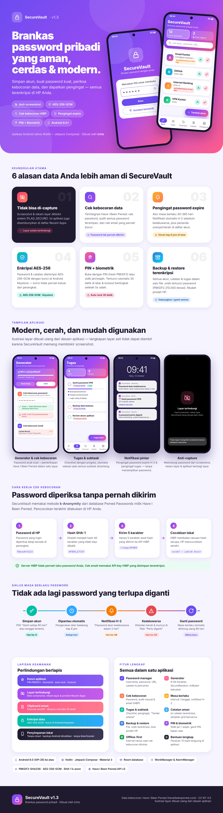

# SecureVault v1.3 — Password Manager Android

Brankas password pribadi yang aman, cerdas & modern untuk Android (Kotlin + Jetpack Compose). Dibuat oleh **Ichio**.

[](apk/SecureVault-v1.3.apk)


## Infografis



Infografis di atas merangkum fungsi dan keunggulan utama SecureVault:

| Bagian | Isi |
|---|---|
| **6 keunggulan utama** | Anti-screenshot/rekam layar (FLAG_SECURE), cek kebocoran data via Have I Been Pwned, pengingat password kedaluwarsa (H-2), enkripsi AES-256-GCM di Android Keystore, kunci PIN + biometrik, backup & restore terenkripsi |
| **Tampilan aplikasi** | Generator & cek kebocoran, Tugas & subtask, notifikasi pengingat, dan layar terlindungi saat di-screenshot |
| **Cara kerja cek kebocoran** | Metode *k-Anonymity*: password di-hash SHA-1, hanya 5 karakter awal hash yang dikirim ke HIBP, pencocokan dilakukan di HP |
| **Siklus masa berlaku** | Simpan akun → dipantau otomatis → notifikasi H-2 → kedaluwarsa (penanda merah) → ganti password & siklus baru |
| **Lapisan keamanan & fitur** | 5 lapis perlindungan, 10 fitur utama, dan spesifikasi teknis |

> **Catatan:** tampilan layar pada infografis adalah ilustrasi yang dibuat ulang dari desain aplikasi — screenshot asli tidak bisa diambil karena SecureVault memang memblokir screenshot dan rekam layar.
>
> File: [PNG resolusi tinggi](docs/infografis/securevault-infografis.png) · [PDF](docs/infografis/securevault-infografis.pdf) · [Sumber HTML](docs/infografis/securevault-infografis.html)

## Download & instal

1. Unduh [`apk/SecureVault-v1.3.apk`](apk/SecureVault-v1.3.apk) (atau dari halaman **Releases**).
2. Buka file di HP Android 8.0+, izinkan *"Install unknown apps"* bila diminta.
3. Buat PIN saat pertama kali dibuka.

APK juga dibangun otomatis oleh GitHub Actions (`.github/workflows/build-apk.yml`) setiap ada push — unduh dari tab **Actions → Artifacts**.

## Fitur
- **Akun & Password**: simpan nama layanan, username, password, URL, catatan; cari; salin username/password (clipboard ditandai sensitif & dibersihkan otomatis 30 detik).
- **Generator Password**: panjang 6–64, huruf besar/kecil, angka, simbol, hindari karakter mirip, indikator kekuatan (SecureRandom).
- **Catatan**: catatan bebas, isi terenkripsi.
- **Backup**: semua akun, password & catatan → file `.svbk` terenkripsi password backup (PBKDF2-SHA256 210.000 iterasi + AES-256-GCM). Lokasi bebas (penyimpanan lokal, Google Drive, dsb. via Storage Access Framework).
- **Restore**: dari file `.svbk` (perangkat yang sama atau lain), mode *Gabungkan* (duplikat dilewati) atau *Ganti semua*.
- **Masa berlaku password**: interval ganti (30–365 hari, otomatis diperbarui saat password diganti) atau tanggal tertentu; penanda oranye/merah dan filter "perlu diganti".
- **Notifikasi**: pengingat otomatis 2 hari sebelum password kedaluwarsa dan saat sudah kedaluwarsa (WorkManager, cek tiap 6 jam).
- **Tugas**: daftar tugas dengan subtask (checklist), otomatis selesai saat semua subtask dicentang, pengingat notifikasi opsional (AlarmManager, tetap jalan setelah restart) dengan aksi "Tandai selesai".
- **Cek kebocoran data (Have I Been Pwned)**: cek password (Pwned Passwords, k-anonymity, gratis), audit semua password tersimpan, dan cek email (API key HIBP berlangganan, disimpan terenkripsi).
- **Bantuan & Tentang**: panduan pemakaian lengkap (Pengaturan → Bantuan) dan info aplikasi (Pengaturan → Tentang aplikasi).
- **Kunci aplikasi**: PIN 4–12 digit (disimpan sebagai hash PBKDF2) + biometrik opsional; terkunci otomatis 30 detik di background; lockout bertingkat setelah 5x salah.
- **Keamanan lain**: password & catatan dienkripsi AES-256-GCM dengan kunci di Android Keystore, `FLAG_SECURE` (blok screenshot), `allowBackup=false`, internet hanya dipakai untuk cek kebocoran data atas permintaan pengguna.

## Cara build dari source
1. Buka folder ini di **Android Studio** (Ladybug 2024.2 atau lebih baru), JDK 17+.
2. Tunggu Gradle sync (otomatis mengunduh Gradle 8.11.1 & dependensi).
3. Run ▶ ke HP/emulator (Android 8.0 / API 26+), atau `./gradlew assembleDebug` → `app/build/outputs/apk/debug/app-debug.apk`.
4. Untuk rilis: Build ▸ Generate Signed App Bundle / APK.

## Struktur
```
app/src/main/java/id/pln/securevault/
├─ MainActivity.kt, SecureVaultApp.kt
├─ crypto/    CryptoManager (Keystore AES-GCM), PasswordCrypto (PBKDF2, enkripsi backup)
├─ security/  PinManager, AppLock (auto-lock), BiometricHelper
├─ data/      Room entity/DAO/database, VaultRepository
├─ backup/    BackupManager (export/import JSON terenkripsi)
├─ util/      PasswordGenerator, ClipboardHelper
└─ ui/        VaultViewModel, AppRoot (navigasi), screens/, theme/
```

## Catatan penting
- **Password backup tidak bisa dipulihkan** bila lupa — file backup tidak dapat dibuka tanpanya.
- Data di HP terikat pada kunci Keystore perangkat; pindah HP / reset pabrik **wajib** lewat Backup → Restore.
- Jika lupa PIN aplikasi: hapus data aplikasi (Settings ▸ Apps ▸ SecureVault ▸ Clear data), lalu restore dari backup.
- Biometrik berfungsi sebagai gerbang buka aplikasi (bukan kunci kriptografis).
